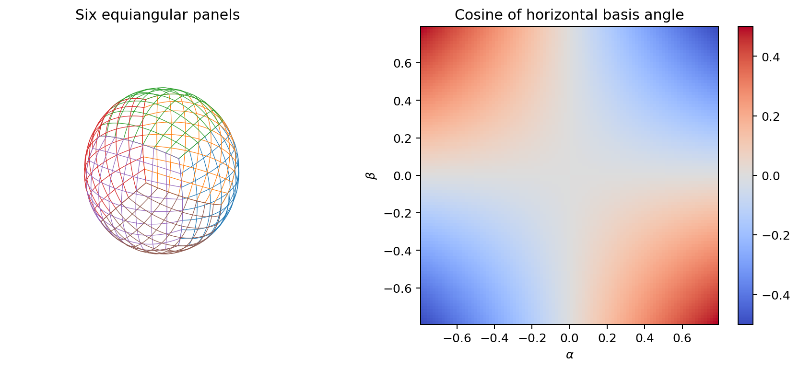
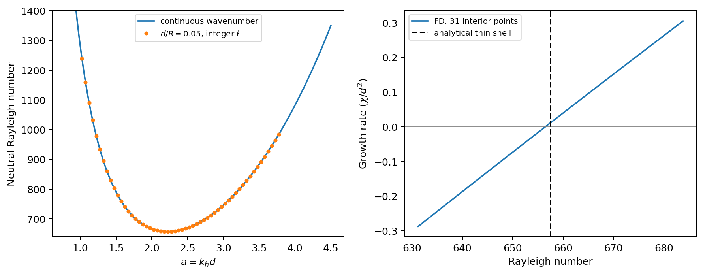
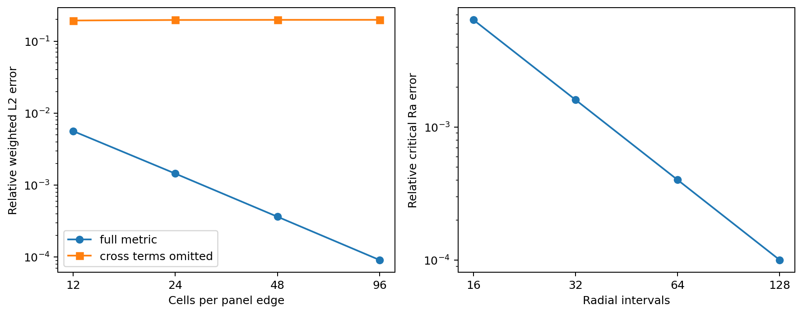
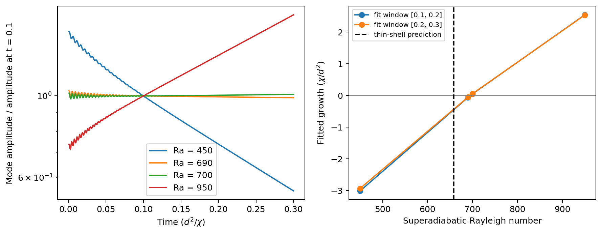
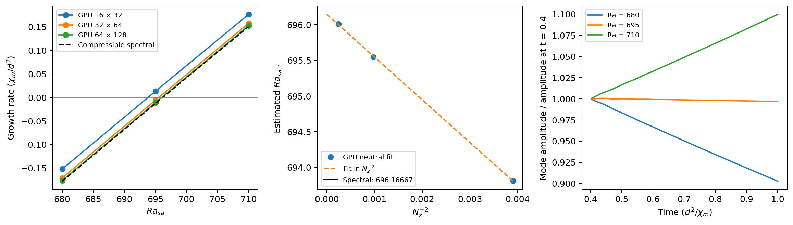

Diffusion, heat conduction, and convection onset on Snapy's cubed sphere
========================================================================

Scope and principal conclusions
-------------------------------

This note derives the physical operators, a thin-shell stability benchmark,
and a numerical design for Snapy. The code audit refers to commit
``a09cc25`` (2026-10-25). The recommended starting point is second-order,
conservative finite-volume diffusion with the full horizontal metric and a
radial implicit solve. This is an engineering recommendation based on the
existing architecture, not a measured performance ranking of implementations.

**Status:** cubed-sphere heat conduction and Newtonian viscosity are now
implemented, with shared conservative seam fluxes, radial thermal/velocity
walls, and optional second-order implicit radial heat conduction. The original
Cartesian-only guard at the audited commit has been replaced by explicit
geometry and boundary requirements. Cartesian diffusion keeps its original
interior stencil and now accepts prescribed conductive x1 wall temperatures.
The sections below distinguish the independent Python calculation, the C++
operator regression, and full compressible runs.

The added planar verification compares GPU snapy runs with an independent
spectral solution of the fully compressible equations from
[AlboussiereRicard2017]_. At :math:`a=1,{\cal D}=0.5,\gamma=5/3`, the
64-by-128-cell GPU threshold is :math:`696.00945`, within 0.0226 percent of the
compressible reference :math:`696.16667`. The reference is distinct from the
Boussinesq threshold and from the earlier spherical test.

The main analytical result, for impermeable, stress-free, fixed-temperature
walls, is

.. math::

   Ra_{\ell n}=\frac{[n^2\pi^2+\epsilon^2\ell(\ell+1)]^3}
                        {\epsilon^2\ell(\ell+1)},\qquad
   Ra_c=\min_{\ell\geq1}Ra_{\ell1},\quad \epsilon=d/R\ll1.

This is a **leading-order thin-shell model**, retaining discrete spherical
harmonic degrees, not the exact finite-thickness spherical-shell threshold.
As the admissible horizontal wavenumbers become dense,
:math:`Ra_c\rightarrow27\pi^4/4=657.5113645`. No-slip walls have a different
threshold; changing wall conditions is not a compressibility correction.

Notation and geometry
---------------------

.. list-table:: Physical and numerical conventions
   :header-rows: 1
   :widths: 22 48 30

   * - Symbol
     - Meaning
     - Units / convention
   * - :math:`r,\alpha,\beta`
     - Radial coordinate and equiangular panel coordinates
     - Snapy :math:`x_1,x_2,x_3`; metres, radians, radians
   * - :math:`r_i,r_o,d,R`
     - Inner/outer radii, thickness, reference radius
     - :math:`d=r_o-r_i`, :math:`R=(r_o+r_i)/2`
   * - :math:`K,\mu`
     - Conductivity and dynamic viscosity
     - W m\ :sup:`-1` K\ :sup:`-1`; Pa s
   * - :math:`\chi,\nu`
     - Boussinesq thermal diffusivity and kinematic viscosity
     - :math:`K/(\rho_0 c_p)`, :math:`\mu/\rho_0`; m\ :sup:`2` s\ :sup:`-1`
   * - :math:`\alpha_T,g,\Delta T`
     - Expansion coefficient, inward gravity magnitude, bottom minus top temperature
     - Positive for the heated-from-below case
   * - :math:`J,\gamma_{ab}`
     - Unit-sphere area Jacobian and angular metric
     - Dimensionless; :math:`a,b\in\{\alpha,\beta\}`

On the +X panel set :math:`X=\tan\alpha`, :math:`Y=\tan\beta`,
:math:`S=1+X^2+Y^2`, with both angles in :math:`[-\pi/4,\pi/4]`. The map is

.. math::

   \boldsymbol{x}(r,\alpha,\beta)
      =r\boldsymbol{n},\qquad
   \boldsymbol{n}=\frac{(1,X,Y)}{\sqrt S}.

Other panels are rigid rotations of this map. Differentiating it gives
:math:`g_{rr}=1`, :math:`g_{ra}=0`, :math:`g_{ab}=r^2\gamma_{ab}`, where

.. math::

   \gamma_{ab}=\frac{1}{S^2}
   \begin{pmatrix}
   (1+X^2)^2(1+Y^2)&-XY(1+X^2)(1+Y^2)\\
   -XY(1+X^2)(1+Y^2)&(1+Y^2)^2(1+X^2)
   \end{pmatrix},

   J=\sqrt{\det\gamma}=\frac{(1+X^2)(1+Y^2)}{S^{3/2}},\qquad
   \sqrt{\det g}=r^2J,

   \gamma^{\alpha\alpha}=\frac S{1+X^2},\quad
   \gamma^{\beta\beta}=\frac S{1+Y^2},\quad
   \gamma^{\alpha\beta}=\frac{SXY}{(1+X^2)(1+Y^2)}.

Thus the vertical is orthogonal to the surface but the two horizontal
coordinate lines are not mutually orthogonal. Their normalized dot product is
:math:`c=-XY/\sqrt{(1+X^2)(1+Y^2)}`; at panel corners :math:`|c|=1/2`.
This agrees with ``cosine_cell_kj`` in
``src/coord/gnomonic_equiangle.cpp``. The metric convention is also described
by Ullrich, Jablonowski and van Leer [Ullrich2010]_.

   Python-generated geometry. Nonorthogonality remains finite under refinement.

Scalar diffusion and heat conduction
------------------------------------

For a scalar :math:`\phi`, let :math:`\boldsymbol{F}=-D\nabla\phi`.
The coordinate components are :math:`F^i=-Dg^{ij}\partial_j\phi`, and
:math:`\nabla\cdot\boldsymbol F=(r^2J)^{-1}\partial_i(r^2JF^i)`.
Consequently, the positive diffusion operator is

.. math::

   \mathcal L_D\phi=\nabla\cdot(D\nabla\phi)
   =\frac1{r^2}\partial_r(r^2D\partial_r\phi)
    +\frac1{r^2J}\partial_a(JD\gamma^{ab}\partial_b\phi).

For constant :math:`D`, this becomes
:math:`D[r^{-2}\partial_r(r^2\partial_r\phi)+r^{-2}\Delta_\Omega\phi]`.
For a mass fraction, use :math:`\rho D` in the flux and update
:math:`\rho\phi` conservatively; do not apply a temperature equation to species.
A positive radial/horizontal diffusivity tensor
:math:`\boldsymbol D=D_r\boldsymbol n\boldsymbol n+
D_h(\boldsymbol I-\boldsymbol n\boldsymbol n)` replaces :math:`D` by
:math:`D_r` in the first term and :math:`D_h` in the second. Geometric
anisotropy of the grid does not itself justify different physical coefficients.

For conduction, :math:`\boldsymbol q=-K\nabla T`. The compressible equations
with total energy density :math:`E=\rho e+\rho|\boldsymbol u|^2/2` contain

.. math::

   \partial_t E+\nabla\cdot[(E+p)\boldsymbol u]
      =\rho\boldsymbol g\cdot\boldsymbol u
       +\nabla\cdot(\boldsymbol\tau\cdot\boldsymbol u)-\nabla\cdot\boldsymbol q,

   \rho c_v\frac{DT}{Dt}
      =-p\nabla\cdot\boldsymbol u+\mathcal L_K T
        +\boldsymbol\tau:\nabla\boldsymbol u

for a calorically perfect, fixed-composition gas. Conductivity belongs inside
the divergence. The latter temperature equation is not interchangeable with
:math:`\partial_tT=\chi\Delta T` in a compressible convection experiment.

For constant :math:`K`, no internal heating, and uniform wall temperatures,

.. math::

   T_c(r)=T_o+B\left(\frac1r-\frac1{r_o}\right),\quad
   B=\frac{\Delta T}{1/r_i-1/r_o},\quad
   q_r=\frac{KB}{r^2},\quad L=4\pi KB.

For radial :math:`K(r)`, the luminosity remains constant and
:math:`T_c'=-L/(4\pi r^2K)`. A linear radial temperature is only a thin-shell
approximation. Initialize hydrostatic pressure from
:math:`p_c'=-\rho_c g(r)` and the EOS; conductive and hydrostatic balance must
both be satisfied. For an ideal gas one can integrate
:math:`\ln[p_c(r)/p_c(r_i)]=-\int_{r_i}^r g/(R_sT_c)\,dr` before applying
Snapy's discrete balance procedure.

Viscosity is a tensor operator
------------------------------

The Newtonian stress, with zero bulk viscosity (Stokes hypothesis), is

.. math::

   \tau^{ij}=\mu\left(\nabla^i u^j+\nabla^j u^i
                 -\tfrac23g^{ij}\nabla_k u^k\right),\qquad
   \nabla_j\tau^{ij}=\frac1{\sqrt g}\partial_j(\sqrt g\tau^{ij})
                         +\Gamma^i_{jk}\tau^{jk}.

Applying the scalar Laplacian separately to panel velocity components loses
basis derivatives and is not a valid viscous stress. A practical alternative
is to reconstruct the Cartesian velocity gradient at face quadrature points,
form the Cartesian stress, and integrate the traction
:math:`\boldsymbol\tau\cdot\boldsymbol n_f`. Use a compatible projection into
Snapy's stored momentum basis, including geometric terms required by that
basis; simply projecting a cell-centre force need not give exact discrete
angular-momentum balance. Test that balance separately. The associated total
energy flux is :math:`-\boldsymbol u_f\cdot\boldsymbol\tau\cdot\boldsymbol n_f`
plus :math:`q_n` in the conservative left-hand-side flux convention.

A useful exact test is rigid rotation :math:`\boldsymbol u=\boldsymbol\Omega
\times\boldsymbol x`: its strain and viscous heating must vanish. Radial
stress-free walls mean :math:`u_r=0`, :math:`\tau_{r\theta}=\tau_{r\varphi}=0`.
For a smooth impermeable spherical wall these imply
:math:`\partial_r(u_\theta/r)=\partial_r(u_\varphi/r)=0`, not simply zero
radial derivatives of tangential physical velocities. These reduce to the
flat-wall conditions only at leading thin-shell order.

Thin-shell onset derived with spherical harmonics
-------------------------------------------------

Assume no rotation, magnetic field, internal heating or composition gradients;
constant :math:`\nu,\chi,\alpha_T`, approximately constant inward gravity;
and Boussinesq density variations only in buoyancy. Use
:math:`z=(r-r_i)/d`, :math:`\epsilon=d/R`, time unit :math:`d^2/\chi`,
velocity unit :math:`\chi/d`, and perturbation temperature unit :math:`\Delta T`.
To leading order in :math:`\epsilon`, the conductive gradient is
:math:`-\Delta T/d` and the linear equations are

.. math::

   Pr^{-1}\partial_t\boldsymbol u=-\nabla\pi+\nabla^2\boldsymbol u
                                  +Ra\theta\boldsymbol e_r,\quad
   \nabla\cdot\boldsymbol u=0,\quad
   \partial_t\theta-w=\nabla^2\theta,

   Ra=\frac{g\alpha_T\Delta T d^3}{\nu\chi},\qquad Pr=\frac\nu\chi.

The derivatives here have lengths scaled by :math:`d`. Expand
:math:`w=W(z)Y_\ell^m(\Omega)e^{\sigma t}` and
:math:`\theta=\Theta(z)Y_\ell^m(\Omega)e^{\sigma t}`. The unit-sphere identity

.. math::

   \Delta_\Omega Y_\ell^m=-\ell(\ell+1)Y_\ell^m

replaces the flat horizontal wavenumber by
:math:`a_\ell^2=\epsilon^2\ell(\ell+1)`.
Taking the radial component of the double curl of momentum eliminates pressure.
Writing :math:`D_z=d/dz` and :math:`A=-D_z^2+a_\ell^2`, the result is

.. math::

   (Pr^{-1}\sigma+A)AW=Ra\,a_\ell^2\Theta,\qquad
   (\sigma+A)\Theta=W.

At stress-free, impermeable, isothermal walls:
:math:`W=D_z^2W=\Theta=0` at :math:`z=0,1`.
Hence :math:`W,\Theta\propto\sin(n\pi z)`, :math:`n\geq1`, and
:math:`Q=n^2\pi^2+a_\ell^2` gives the dispersion relation

.. math::

   (\sigma/Pr+Q)Q(\sigma+Q)=Ra\,a_\ell^2.

For positive :math:`Pr`, onset is stationary: substituting
:math:`\sigma=i\omega` makes the imaginary part proportional to
:math:`\omega Q^2(1+Pr^{-1})`, so neutrality requires :math:`\omega=0`.
Thus :math:`Ra_{\ell n}=Q^3/a_\ell^2`. At fixed :math:`\ell`, :math:`n=1`
is the minimum. Minimizing over continuous :math:`a` gives

.. math::

   a_c=\frac\pi{\sqrt2},\qquad Ra_c^{\mathrm{plane}}=\frac{27\pi^4}{4},\qquad
   \ell_*^{\mathrm{continuous}}=
       \frac{-1+\sqrt{1+2\pi^2/\epsilon^2}}2.

Evaluate the adjacent positive integer degrees to choose the spherical mode;
all :math:`m=-\ell,\ldots,\ell` are degenerate in the continuum. The
:math:`\ell=0` mode cannot support an incompressible radial circulation between
impermeable walls. The discrete-degree correction to the minimum is
:math:`O(\epsilon^2)` because the continuous minimum is stationary. It need
not vary monotonically with thickness as the winning integer changes.

**Do not interpret this discrete-degree correction as all curvature effects.**
The radial :math:`2\partial_r/r` term, varying :math:`r^{-2}` horizontal
factor, :math:`T_c'\propto r^{-2}`, gravity profile, and exact stress conditions
have been approximated. Their finite-shell corrections depend on the
specified physical model and reference scaling, and can enter at
:math:`O(\epsilon)`. Araki et al. [Araki1994]_ derive gravity-dependent
thin-layer corrections. A finite-shell calculation requires the radial
poloidal-velocity/temperature eigenproblem with these terms retained.
Morison et al. [Morison2024]_ provide a spherical-shell stability treatment;
their permeable/phase-change variants are not the wall conditions assumed here.

For no-slip, isothermal walls impose :math:`W=D_zW=\Theta=0`; the sine ansatz
is then invalid. Solve the resulting sixth-order boundary-value eigenproblem
instead. Insulating or fixed-flux thermal walls likewise require a different
neutral curve. A generic reflecting hydrodynamic boundary is not by itself an
isothermal wall.

   Leading-order spherical-harmonic spectrum and the independent finite-
   difference growth-rate calculation; neither curve is a Snapy simulation.

Recommended discretization and integration into Snapy
-----------------------------------------------------

For each cell, retain the existing area/volume divergence structure:

.. math::

   V_c\frac{dU_c}{dt}=-\sum_{f\in\partial c}s_{cf}\mathcal F_f,\qquad
   \mathcal F_f=\int_f F_n\,dA.

``CoordinateImpl::divergence`` in ``src/coord/coordinate.cpp`` multiplies
supplied flux densities by face areas. Supply :math:`\mathcal F_f/A_f`, not
an already integrated flux or a raw angular contravariant component.
Use the exact volumes and areas in ``GnomonicEquiangleImpl``. In particular,
:math:`V=\Delta\Omega(r_+^3-r_-^3)/3` and
:math:`A_r=r_f^2\Delta\Omega`; :math:`\Delta\Omega` is the exact cell solid
angle, not centre :math:`J\Delta\alpha\Delta\beta` when exact geometry exists.

Horizontal fluxes
~~~~~~~~~~~~~~~~~

For an :math:`\alpha` face with normal in the positive coordinate direction,

.. math::

   q_n=-\frac K r\left[
       \sqrt{\gamma^{\alpha\alpha}}\,\partial_\alpha T
       +\frac{\gamma^{\alpha\beta}}{\sqrt{\gamma^{\alpha\alpha}}}
          \partial_\beta T\right],\qquad
   dA=rJ\sqrt{\gamma^{\alpha\alpha}}\,dr\,d\beta.

The :math:`\beta` expression follows by interchange. A two-point difference
normal to a coordinate face does not recover this expression: it needs a
transverse derivative. Begin with centred face differences, a centred
transverse gradient averaged to that face, and matching metric quadrature.
For general stretched meshes use polynomial reconstruction with physical
centre positions, rather than dividing a symmetric difference by twice a
single width. At coefficient jumps use normal resistance/harmonic averaging;
for smooth coefficients, reconstruct the full physical product :math:`K` or
:math:`\rho\nu` to the face. Preserve the existing mean-of-products correction
in ``docs/derivations/diffusion-face-coefficient.md``.

At panel boundaries transform gradients/tractions to a common Cartesian or
shared face basis and compute **one physical integrated flux** shared with
opposite signs by both cells. Ghost interpolation alone does not establish
this equality. The seam closure must have the same accuracy and a compatible
conservative adjoint as the interior. Check corners separately; an interior
nine-point angular stencil adds diagonal halo dependencies.

Conservation does not alone establish dissipation. Prefer a compatible
multipoint/mimetic construction with discrete gradient :math:`G`, positive
metric/coefficient inner product :math:`H`, and divergence its negative
volume-weighted adjoint:

.. math::

   M\dot T=-G^T H G T,\qquad
   \frac12\frac d{dt}(T^TMT)=-(GT)^TH(GT)\leq0.

Here :math:`M` contains volume times the frozen volumetric heat capacity
for the isolated conduction step. Assemble boundary terms consistently.
A generic nonorthogonal correction is not automatically symmetric or
monotone; prove or measure its spectrum. SPD energy stability also does not
guarantee a discrete maximum principle. Require positive-temperature tests
for sharp gradients before using it in production. The simple panel script
below verifies consistency only, not this complete seam-coupled construction.
Calhoun and Helzel [Calhoun2009]_ establish a second-order finite-volume
approach for curved parametric surfaces; that supports the method family,
not an assertion that their particular scheme has already been ported here.

Radial fluxes and time stepping
~~~~~~~~~~~~~~~~~~~~~~~~~~~~~~~

The radial direction has no angular cross derivative. For cell-centre values
:math:`T_L,T_R` an equilibrium-preserving radial conductance is

.. math::

   \mathcal F_r=-\Delta\Omega\,
      \frac{T_R-T_L}{\displaystyle\int_{r_L}^{r_R}\frac{dr}{r^2K(r)}}.

With constant :math:`K`, the denominator is
:math:`(1/K)(1/r_L-1/r_R)`. This reproduces the luminosity of
:math:`T=A+B/r` exactly for point samples at centres; it is second-order for
smooth fields. True cell averages require reconstruction using the radial
volume measure before invoking that exact-balance claim. Use the physical
wall radius as one endpoint for a prescribed temperature, and directly
specify luminosity for a fixed-flux wall. A plain :math:`K_fA_f/\Delta r`
conductance is consistent but does not have this exact equilibrium property.

Thin shells usually have :math:`\Delta r\ll r\Delta\alpha`. Explicit
conduction then costs :math:`\Delta t=O(\Delta r^2/\chi_v)`, with
:math:`\chi_v=K/(\rho c_v)` for an isolated compressible conduction update.
Start with explicit stepping to validate space; next add an IMEX method with
an implicit radial diffusion stage and explicit horizontal diffusion and
advection. With frozen positive coefficients, the scalar radial solve is
tridiagonal per column and well suited to batched GPU solves. Use a
second-order L-stable implicit stage paired with a documented second-order
explicit tableau; do not claim second order from arbitrary splitting.
Backward Euler is a useful first-order reference, while Crank--Nicolson can
retain oscillatory high-frequency errors for very stiff diffusion.

Radial viscosity generally couples components and geometric terms; use an
appropriate block solve rather than assuming the heat tridiagonal applies
unchanged. Nonlinear EOS/conductivity requires iteration or a justified lagged
coefficient treatment. The acoustic vertical implicit correction in
``src/implicit`` does not automatically make forcing diffusion implicit.
For a column split between MPI ranks, use a distributed line solve or restrict
the initial implementation to ``nb1=1`` with an explicit diagnostic.

For explicit horizontal stages choose the timestep from a verified spectral
bound for the actual metric/cross-term operator. For a symmetric negative
operator, forward Euler needs :math:`\Delta t\leq2/|\lambda_{\min}|`;
other explicit stages have their own stability interval. A Cartesian
minimum-width estimate must not be transplanted without verifying the metric
and viscous eigenvalues. Keep the acoustic, advective and diffusion bounds
separate.

.. list-table:: Scheme choice for this repository
   :header-rows: 1
   :widths: 24 40 36

   * - Candidate
     - Advantage
     - Limitation / decision
   * - Coordinate-wise two-point diffusion
     - Small stencil
     - Inconsistent horizontally without cross terms; reject
   * - Full-metric conservative second-order FV
     - Fits existing cells, areas, volumes and flux divergence
     - Recommended baseline; seam and dissipation work required
   * - Radial-implicit / horizontal-explicit FV
     - Removes the thin radial diffusion timestep
     - Recommended after spatial validation; new diffusion stage needed
   * - Fully implicit 3-D diffusion
     - Removes horizontal restriction too
     - Global solve and preconditioner; use if horizontal diffusion dominates
   * - Global spherical-harmonic diffusion
     - Exact angular eigenvalues for constant coefficients
     - Excellent reference; awkward for panel-local data and variable coefficients
   * - Higher-order FV or DG
     - Potentially lower smooth-solution error
     - Greater seam/halo complexity; defer until second-order benchmark passes

.. list-table:: Baseline audit and implementation touch points
   :header-rows: 1

   * - Location
     - Finding / required work
   * - ``src/forcing/diffusion.cpp``
     - Original Cartesian path retained; dispatches to the new cubed-sphere
       gradient/traction path and supports the radial implicit timestep split
   * - ``src/coord/gnomonic_equiangle.cpp``
     - Exact areas/volumes and normalized horizontal angle; expose consistent face metrics
   * - ``src/coord/cubed_sphere_utils.cpp``
     - Velocity basis transforms; these use normalized panel components, not raw
       coordinate velocities :math:`d\alpha/dt,d\beta/dt`
   * - ``src/layout/cubed_sphere_layout.cpp`` and mesh exchange
     - Existing topology reused by the new shared diffusive face-flux exchange
   * - ``src/hydro/register_forcing_modules.cpp`` and ``src/implicit``
     - Explicit diffusion remains a forcing module; optional radial heat half-steps
       are integrated by MeshBlock independently of the acoustic implicit solver
   * - ``tests/test_diffusion*.cpp`` and ``tests/test_cubed_sphere_cell_volume.py``
     - Preserve Cartesian coefficient/EOS behavior; extend geometry, seam and wall coverage

Compressible-to-Boussinesq comparison
-------------------------------------

For an ideal gas the entropy equation can be written

.. math::

   \rho T\frac{Ds}{Dt}=\nabla\cdot(K\nabla T)+\Phi,\qquad
   \rho c_p\frac{DT}{Dt}-\frac{Dp}{Dt}=\nabla\cdot(K\nabla T)+\Phi.

Using the hydrostatic background pressure gradient gives the low-Mach
linear temperature equation

.. math::

   \partial_t T'+u_r\left(T_c'+\frac g{c_p}\right)
      =\chi\nabla^2T',\qquad \chi=\frac K{\rho_0c_p}.

For a thin, weakly stratified layer, the buoyancy-driving temperature drop is
:math:`\Delta T_{sa}=\Delta T-gd/c_p`. Compare using

.. math::

   Ra_{sa}=\frac{g\alpha_T\Delta T_{sa}d^3}{\nu\chi},\qquad
   \alpha_T=1/T_0.

For variable gravity or heat capacity replace :math:`gd/c_p` by the
appropriate radial integral. At substantial stratification, a single midpoint
Rayleigh number is only a convention: solve the compressible or anelastic
linear stability problem for the actual profiles. If
:math:`\Delta T_{sa}\leq0`, this dry nonrotating buoyancy instability is absent.

**Snapy's coefficient conversion is essential.** In the current source,
``dynamic: false`` uses :math:`K=\rho c_v\,\mathtt{kappa\_iso}` (including any
radial scale). Thus for constant composition and no scale,
:math:`\chi=\mathtt{kappa\_iso}/\gamma`, :math:`\gamma=c_p/c_v`.
``nu_iso`` is then :math:`\nu`. With ``dynamic: true``, ``kappa_iso`` is
:math:`K` and ``nu_iso`` is :math:`\mu`; evaluate
:math:`\chi=K/(\rho_0c_p)` and :math:`\nu=\mu/\rho_0` at the stated reference
radius. The labels do not change the physical units of these inputs.

A clean benchmark uses a dry gas and constant dynamic :math:`K,\mu`, hence
an exactly known conductive profile. For chosen target :math:`Ra_{sa},Pr`
and driving :math:`B_*=g\alpha_T\Delta T_{sa}d^3`, set
:math:`\chi=\sqrt{B_*/(Pr\,Ra_{sa})}`, :math:`\nu=Pr\chi`,
:math:`K=\rho_0c_p\chi`, :math:`\mu=\rho_0\nu`.
Require :math:`\Delta T/T_0\ll1`, :math:`d/H_p\ll1`,
:math:`H_p=R_sT_0/g`, and small Mach number. To approach the literal
Boussinesq temperature-drop experiment also take
:math:`gd/(c_p\Delta T)\ll1`. Low Mach number alone does not remove
stratification or the adiabatic gradient. Near-onset growth is very slow,
so even a formally low-Mach flow can be strongly affected by acoustic
Riemann-solver dissipation.

Numerical results produced for this note
----------------------------------------

Run from the repository root (NumPy, SciPy and Matplotlib required)::

   python docs/notes/cubed_sphere_checks.py

The script writes three figures, the following tables and
``cubed_sphere_results.json``. Its assertions test:

* The full metric on all six rotated panels, using the degree-two harmonic
  :math:`f=n_xn_y` with :math:`\Delta_\Omega f=-6f`. Ghost values are analytic
  continuations, so **actual seam exchange is not tested**. Errors compare
  the discrete divergence with the pointwise eigenfunction; the difference
  between point and cell-averaged references is also second-order.
* Exact total sphere area from integrated cell solid angles.
* The radial resistance formula for point samples of :math:`T=3+2/r`.
* An independent second-order radial stability eigenproblem, using the
  standard Dirichlet second-difference matrix :math:`A_h=-D_{zz,h}+a_\ell^2I`.
  Its neutral eigenvalues are those of :math:`A_h^3/a_\ell^2`.
  These boundary closures implement the stress-free sine eigenbasis.
* A separate eigenvalue computation of the coupled time-dependent block
  matrix, followed by a root search for zero growth; positive and negative
  growth are checked at 1.02 and 0.98 times the analytical threshold.

At :math:`d/R=0.05`, the minimizing degree is :math:`\ell=44` and the
analytical thin-shell threshold is **657.51343756**. The 127-interior-point
radial discretization gives **657.44749523**, a relative error of
:math:`1.003\times10^{-4}`, with order approaching 2. The 31-point growth
root is 656.45920656; dimensionless growth rates at 0.98 and 1.02 of the
analytical threshold are -0.13710 and +0.15939 at :math:`Pr=1`.
The radial resistance luminosity error is below :math:`3\times10^{-12}`.

.. include:: cubed_sphere_tables.inc

   Full-metric panel errors decrease at second order. Omitting cross terms
   leaves approximately 19.8% relative error in this manufactured solution.

Compressible onset validation protocol
--------------------------------------

The independent eigenproblem is a benchmark generator, not a substitute for
the end-to-end test. The included compressible runner supplies the initial
experiment; use the following protocol for a resolved neutral curve:

1. Validate diffusion alone before coupling buoyancy. Test constant fields,
   radial conductive balance, angular harmonic decay
   :math:`e^{-\chi\ell(\ell+1)t/R^2}`, global heat conservation on an insulated
   shell, rigid-rotation strain, viscous energy transfer, and nonnegative
   discrete dissipation. Run panel-interior, seam, corner and MPI-decomposition
   comparisons. For a thick shell, angular decay alone is not a separable
   radius-independent solution; use a surface operator or the thin-shell
   limit for this test.
2. Use all six panels, dry EOS, prescribed wall temperatures, impermeable
   stress-free velocity conditions, and constant dynamic :math:`K,\mu`.
   Construct :math:`T_c(r)` and a discrete hydrostatic pressure state. Run the
   unperturbed state until its residual drift is negligible relative to the
   imposed perturbation; quantify that drift instead of assuming balance.
3. At :math:`d/R=0.05`, seed :math:`\ell=44` and nearby degrees 43 and 45,
   with :math:`T'\propto\sin(\pi z)Y_\ell^m`, amplitude initially
   :math:`10^{-6}\Delta T_{sa}`. A compatible leading-order poloidal velocity
   has :math:`u_r=W(r)Y_\ell^m` and
   :math:`\boldsymbol u_h=[\partial_r(r^2W)/(r\ell(\ell+1))]
   \nabla_\Omega Y_\ell^m`; its divergence vanishes. An eigenfunction satisfying
   the exact finite-shell stress conditions is preferable for thicker shells.
4. Resolve the preferred horizontal wavelength
   :math:`2\pi R/\sqrt{\ell(\ell+1)}`. For :math:`N` cells per panel edge,
   centre-grid sampling gives about :math:`4N/\sqrt{\ell(\ell+1)}` cells per
   wavelength. At :math:`\ell=44`, use at least :math:`N=128` as a starting
   resolution (about 11.5 cells per wavelength), then 192 and 256; this is a
   resolution study, not a guarantee of accuracy. Pair with 32, 64 and 128
   radial cells; also perform separate horizontal/radial refinements.
5. Scan :math:`Ra_{sa}` around the predicted threshold (initially 0.9--1.1
   times it, expanding if necessary). Measure the volume-weighted harmonic
   projection of radial velocity onto each trial radial eigenfunction.
   Fit :math:`\log|A_{\ell m}(t)|` after acoustic/thermal transients and before
   nonlinear saturation. If using kinetic energy, divide its logarithmic
   slope by two. Vary the fitting window and perturbation amplitude by a
   factor of ten; require the inferred growth rate to be stable.
6. Bracket negative/positive growth and interpolate or bisect to
   :math:`\sigma=0`, reporting the bracket and fitting uncertainty. Near
   threshold integrate for several measured growth/decay times, not merely
   a fixed number of sound-crossing times. Refine time step independently.
   Repeat several :math:`m` and rotated initial patterns: grid-induced
   splitting of the continuum degeneracy must decrease on refinement.
7. Report :math:`Ra_{sa}`, :math:`Pr`, :math:`d/R`, :math:`d/H_p`,
   :math:`\Delta T/T_0`, Mach number, coefficients and their units, boundary
   conditions, mesh, timestep, and fit windows. Reduce stratification and
   thickness separately. A persistent discrepancy cannot be attributed to
   compressibility until spatial/time errors, seam errors, coefficient
   conventions and boundary differences have been excluded.

A sensible initial acceptance target is a numerical neutral bracket narrower
than 0.5% and a grid/time-extrapolated discrepancy below 1% **only after**
finite-shell and compressibility corrections have independently been made
smaller than that tolerance. Those are proposed criteria, not achieved results.
For the :math:`\epsilon=0.05` example, no sub-percent agreement with the
leading-order curve should be presumed without a finite-shell reference.

Implementation and measured validation
--------------------------------------

``src/forcing/diffusion_cubed_sphere.cpp`` reconstructs temperature and Cartesian
velocity at physical faces using local four-point polynomials. The horizontal
heat flux uses the analytic nonorthogonal metric derived above. Velocity and
the Cartesian coordinate map use identical derivative stencils; inverting the
map Jacobian via its explicit reciprocal basis makes every affine Cartesian
velocity gradient exact, including
zero strain for rigid rotation. Velocity traces are corrected to the geometric
face position. Radial heat flux uses the exact spherical resistance.

Each horizontal block boundary exchanges the outward integrated flux,
reconstructed traces, dynamic coefficients and normal centre-to-face distances.
Both cells use the same averaged physical flux with opposite signs. A symmetric
jump penalty couples discontinuous panel states, so piecewise constant panels
cannot become artificial insulating regions. Cartesian vector channels are
exchanged as scalars, without rotating them twice. No corner ghost interpolation
is used by this operator. This differs from merely adding cross derivatives to
the original Cartesian stencil.

The implementation is conservative and the measured spatial convergence is
second order, although some reconstruction stencils have higher order. The
small-grid weighted symmetric-part eigenvalue check supports dissipation for
the tested configuration; it is not a proof of a maximum principle or of
stability for every variable-coefficient grid. Exact discrete angular-momentum
conservation is not claimed. The current implementation uses tensor operations
and polynomial matrices; further caching/kernel optimization has not been
benchmarked.

Set these additional keys under ``forcing/diffusion``::

   temperature_inner: 1.1   # positive: fixed temperature; zero: insulated
   temperature_outer: 1.0
   wall_velocity: stress-free  # or no-slip
   implicit_radial: true

The geometry must be ``gnomonic-equiangle`` with the ``cubed-sphere`` layout,
``nb1=1``, reflecting radial hydrodynamic boundaries, positive ghost-centre
radii, ``nghost >= 2``, and at least ``max(4, nghost)`` active cells per direction.
The default is explicit diffusion with insulated, stress-free radial walls.
Physical wall conduction does not depend on hydrodynamic temperature ghosts.
All participating blocks must call the operator concurrently (use ``Mesh``).

With ``implicit_radial: true``, ``diffusion_radial.cpp`` applies SDIRK(2,2),
:math:`\gamma=1-1/\sqrt2`, in two Strang half-steps around each complete hydro
step. The column factorization is reused for the two SDIRK stages. This option
requires the dry ideal-gas EOS. Horizontal heat conduction and all viscous
terms stay explicit; their timestep restrictions remain. The radial conductive
restriction is removed. Retries restore the state before the initial half-step.
The method is L-stable and second order, but not unconditionally positivity
preserving; a nonpositive temperature is rejected before committing that column
step. This is separate from the acoustic vertical implicit correction.

The C++ regression tests execute the production operator on all six panels:

.. list-table:: Production-operator checks
   :header-rows: 1

   * - Check
     - Result
   * - Degree-two harmonic relative L2 error, N = 12, 24, 48
     - 0.00448135, 0.00107574, 0.000286183
   * - Constant state, spherical conductive equilibrium and rigid rotation
     - Pass, including shared seams
   * - Heat and total viscous energy conservation; viscous kinetic-energy loss
     - Pass
   * - Six panels split into 24 blocks
     - Constant-state and rigid-rotation checks pass
   * - Piecewise constant panel temperatures
     - Exchange heat; global integrated heat tendency cancels
   * - N = 4 thermal matrix spectral abscissa
     - Approximately -1.2e-16 (constant null mode)
   * - Largest eigenvalue of volume-weighted symmetric part
     - Approximately -4.0e-16
   * - Implicit radial temperature error, 2, 4, 8 steps
     - 0.111514, 0.0251709, 0.00605363 (second-order time convergence)
   * - Implicit radial stiff-step stability, energy conservation, rollback
     - Pass

The Rayleigh--Ritz check projects the actual C++ heat/stress operator onto a
poloidal spherical-harmonic trial mode. At :math:`d/R=0.1`, :math:`\ell=22`,
and 24 radial cells it gives :math:`Ra=652.25` at N=48 and **658.89** at N=96,
compared with the leading-order analytical **657.6493**. The finer-grid
relative difference is about 0.19%. This isolates diffusion discretization;
it does not include compressible acoustic dynamics, hydro advection errors,
or unrestricted changes to the trial eigenfunction.

Full compressible runs
~~~~~~~~~~~~~~~~~~~~~~

``examples/cubed_sphere_convection.cpp`` initializes a conductive/hydrostatic
shell, adds a small poloidal mode and isobaric thermal perturbation, and evolves
Snapy's compressible equations. It outputs the volume-weighted radial-velocity
mode projection and radial RMS velocity. It uses fixed dynamic coefficients
with the explicit :math:`c_p` conversion, :math:`Pr=1`, a superadiabatic Rayleigh
number, and LMARS/WENO5 hydrodynamics. The discrete hydrostatic balancing step
can slightly change the analytic conductive temperature profile; the
unperturbed control measures the resulting drift.

The initial suite uses N=24, 12 radial cells, :math:`d/R=0.2`,
:math:`d/H_p\simeq0.09524`, :math:`\Delta T/T_0\simeq0.09524`, and perturbation
amplitude :math:`10^{-5}`. This is a **coarse, moderately stratified** onset
check, not a continuum extrapolation or a strict Boussinesq limit.

Reproduce the runs from the repository root::

   cmake --build build --target cubed_sphere_convection.release -j 12
   build/bin/cubed_sphere_convection.release examples/cubed_sphere_convection.yaml 450 0.3 24 12 0.2 /tmp/snapy-onset-450.csv 1e-5
   build/bin/cubed_sphere_convection.release examples/cubed_sphere_convection.yaml 690 0.3 24 12 0.2 /tmp/snapy-onset-690.csv 1e-5
   build/bin/cubed_sphere_convection.release examples/cubed_sphere_convection.yaml 700 0.3 24 12 0.2 /tmp/snapy-onset-700.csv 1e-5
   build/bin/cubed_sphere_convection.release examples/cubed_sphere_convection.yaml 950 0.3 24 12 0.2 /tmp/snapy-onset-950.csv 1e-5
   build/bin/cubed_sphere_convection.release examples/cubed_sphere_convection.yaml 700 0.08 24 12 0.2 /tmp/snapy-onset-rest.csv 0
   build/bin/cubed_sphere_convection.release examples/cubed_sphere_convection.yaml 700 0.3 24 12 0.2 /tmp/snapy-onset-small-seed.csv 1e-6
   python docs/notes/analyze_snapy_onset.py --input-dir /tmp

The run arguments after the YAML path are Rayleigh number, end time in
:math:`d^2/\chi` units, panel resolution, radial resolution, thickness/radius,
CSV path, and perturbation amplitude. The Rayleigh number uses the explicit
nominal reference density 1 and reference temperature (Ti+To)/2; finite-shell
midpoint values differ slightly from these reference values. The runner is a single-process six-block
CPU benchmark; the production diffusion operator also supports distributed
panels. Do not launch this particular runner with multiple MPI processes.

.. include:: snapy_onset_tables.inc

   Production Snapy evolution, with growth fitted in two separate time windows.

The coarse-grid neutral estimate is approximately **Ra = 695**, about **5.5%**
above the leading-order thin-shell value 658.5215 for this thickness. The
additional cases bracket negative/positive late-time growth between 690 and
700; interpolation is an estimate within that bracket, not a precision
continuum threshold. The JSON result records both fit windows, their residuals,
and the effect of reducing perturbation amplitude by ten. The late-window
bracket interpolation gives 694.9202; using the earlier window gives 695.7971.
The maximum relative change after normalizing the ten-times-smaller seed is
9.13e-7. The unperturbed
control's maximum projection onto the seeded harmonic is below 8e-16, while
its maximum radial RMS transient is approximately 1.4e-8.

Finite thickness, stratification, the nominal reference convention, low-Mach
hydrodynamic dissipation, radial resolution and angular resolution can all
contribute to the discrepancy. These runs establish a numerical sign change
with the correct physical scale; they do not separate those contributions or
satisfy the proposed grid/time/stratification-extrapolation criterion. The
saved CSV data in ``onset_samples/`` allow refitting without repeating the
simulations: run ``python docs/notes/analyze_snapy_onset.py``.

Validation commands and compatibility
~~~~~~~~~~~~~~~~~~~~~~~~~~~~~~~~~~~~~

The numerical Python note is reproduced by
``python docs/notes/cubed_sphere_checks.py`` (PASS). Production
regressions are built with::

   cmake -S . -B build
   cmake --build build --target test_diffusion_cubed_sphere.release test_diffusion.release test_diffusion_moist.release test_diffusion_x1_scale.release -j 12
   ctest --test-dir build -R '^test_diffusion(_cubed_sphere|_cubed_sphere_mp|_moist|_x1_scale)?\.release$' --output-on-failure

The freshly rebuilt dry, moist and radial-profile tests pass. The moist
indexing failures originally observed in stale binaries did not reproduce
after the rebuild; no EOS code was changed. The six-panel C++ suite and the two-process Gloo tests pass. The first
sandboxed parallel attempt could not open loopback sockets; after allowing
local sockets, the host's default UCX transport failed during shared-memory
initialization. The CPU parallel regression therefore explicitly selects
Gloo. UCX transport is not validated by this run.
CUDA execution was available outside the restricted sandbox. Double-precision
CPU/GPU comparisons pass for heat fluxes, rigid rotation, viscous shear, the
radial implicit solve, and three complete hydro steps with split radial
conduction. The direct operator test uses distinct block streams and the mesh
test uses the production worker pool. The general CUDA matrix inverse initially
exposed a race in PyTorch's lazy linear-algebra initialization; the production
gradient now uses the equivalent explicit reciprocal-basis formula, avoiding
that initialization path. Multi-process GPU transport was not tested.

The Python extension was rebuilt with
``MAX_JOBS=4 python setup.py build_ext --inplace``. Selecting that rebuilt
package, ``python docs/notes/probe_snapy_diffusion.py`` constructs all
six panels successfully. The probe prints the imported path so an old installed
package cannot be mistaken for this checkout.

A full Sphinx build was unavailable because Sphinx is not installed. The
following Docutils render validates the note with warnings treated as errors::

   python -m docutils --writer=html5 --halt=warning \
     --math-output='MathJax https://cdn.jsdelivr.net/npm/mathjax@3/es5/tex-mml-chtml.js' \
     docs/notes/cubed_sphere_diffusion_convection.rst \
     /tmp/snapy-cubed-sphere-note.html

Cross-repository compatibility: no external repository was changed and the
existing ``dynamic``/:math:`c_v` coefficient semantics are preserved. The added
C++ options change object layouts, so rebuild downstream C++ consumers and the
Python extension together with the library. No new solver runtime dependency
was added; NumPy/SciPy/Matplotlib remain analysis prerequisites. EOS heat-capacity
and communication APIs are reused. Moist/nonlinear implicit conduction,
implicit viscosity, a distributed radial line solve, and a grid/time/
stratification-extrapolated spherical compressible neutral curve remain outside
the implemented scope. The planar compressible verification below removes
curvature and tests a separate Cartesian reference problem.

Compressible planar reference and GPU benchmark
-----------------------------------------------

To separate compressibility from curvature, consider a plane ideal-gas layer
with constant dynamic viscosity :math:`\mu`, constant Fourier conductivity
:math:`K`, uniform downward gravity, fixed temperatures, and impermeable,
stress-free walls. This is the exact compressible stability problem of
[AlboussiereRicard2017]_, sections 5 and 8.1. The values computed below are an
independent reproduction of those equations, not numbers transcribed from a
published table. The production runs use Cartesian snapy on CUDA; the reference
uses NumPy/SciPy Chebyshev collocation on the CPU.

Let :math:`d=T_m=\rho_m=R=1`, with :math:`z\in[-1/2,1/2]`. Define

.. math::

   a=\frac{\Delta T}{T_m},\qquad
   {\cal D}=\frac{gd}{c_pT_m},\qquad
   c_p=\frac{\gamma}{\gamma-1},\qquad g=c_p{\cal D}.

The exact conductive, hydrostatic background is

.. math::

   T_b=1-az,\qquad \rho_b=T_b^{g/a-1},\qquad p_b=T_b^{g/a}.

For the prescribed :math:`Pr=1`, choose

.. math::

   \chi_m=\nu_m=\sqrt{\frac{g(a-{\cal D})}{Ra_{\rm sa}}},\qquad
   \mu=\chi_m,\qquad K=c_p\chi_m.

Here :math:`\chi_m=K/(\rho_m c_p)` is the thermal diffusivity in the
Rayleigh number. It is not :math:`K/(\rho_m c_v)`, the diffusivity controlling
the conservative-energy explicit timestep. The full solver evolves total
energy and includes compressional work. The background density and temperature
are allowed to vary; the comparison makes no Boussinesq or anelastic
approximation.

Independent neutral and growth eigenproblems
~~~~~~~~~~~~~~~~~~~~~~~~~~~~~~~~~~~~~~~~~~~~

Use perturbations proportional to :math:`\exp(ikx+\sigma t)`, with horizontal
velocity amplitude :math:`iU` and vertical velocity amplitude :math:`w`.
Writing :math:`\partial=d/dz` and :math:`L=\partial^2-k^2`, the linearized
dimensional equations in the units above are

.. math::

   \sigma\left(\frac{p'}{T_b}-\frac{\rho_bT'}{T_b}\right)
      &= k\rho_b U-\partial(\rho_b w),\\
   \sigma\rho_b U
      &=-kp'+\mu\left[(\partial^2-4k^2/3)U+(k/3)\partial w\right],\\
   \sigma\rho_b w
      &=-\partial p'-\frac{g}{T_b}p'+\frac{g\rho_b}{T_b}T'
        +\mu\left[(4\partial^2/3-k^2)w-(k/3)\partial U\right],\\
   \sigma(\rho_b c_pT'-p')
      &=\rho_b c_p(a-{\cal D})w+KL T'.

The density time derivative, pressure contribution to buoyancy, and pressure
time derivative in the thermal equation are all retained. Viscous heating is
quadratic in perturbations and does not enter this linear problem. The boundary
conditions are :math:`w=\partial U=T'=0` at both walls. Growth is reported in
units :math:`\chi_m/d^2`.

At stationary onset set :math:`\sigma=0`, :math:`q=p'/\mu` and
:math:`\Theta=gT'/\mu`. The generalized Rayleigh eigenproblem becomes

.. math::

   0&=-k\rho_b U+\partial(\rho_b w),\\
   0&=-kq+(\partial^2-4k^2/3)U+(k/3)\partial w,\\
   0&=-(\partial+g/T_b)q+(4\partial^2/3-k^2)w
       -(k/3)\partial U+(\rho_b/T_b)\Theta,\\
   L\Theta&=-Ra_{\rm sa}\rho_b w.

The mass-flux constraint here follows from setting :math:`\sigma=0` in the
full continuity equation; it is not an anelastic approximation.

``planar_compressible_reference.py`` assembles both matrix pencils independently
of snapy, enforces the six wall conditions, rejects infinite constraint
eigenvalues, and minimizes the lowest positive neutral eigenvalue over
:math:`k`. The time-dependent pencil independently checks the change of sign
of the leading growth rate through that threshold. It also checks the
Boussinesq limit, spectral resolution, and generalized-eigenpair residuals.

For comparison, the published two-mode, second-order approximation (equation
8.9 in the journal version, 8.11 in the arXiv manuscript) is

.. math::

   Ra_{\rm sa,c}\simeq\frac{27\pi^4}{4}
    +\left(2\pi^2-\frac{320}{39}\right)\widetilde{\cal D}^{\,2}
    +\left(\frac{9\pi^4}{8}-\frac{17\pi^2}{4}+\frac{512}{13}\right)
      a\widetilde{\cal D}
    -\left(\frac{27\pi^4}{16}-\frac{63\pi^2}{8}+\frac{1216}{39}\right)a^2,
   \qquad \widetilde{\cal D}=\frac{{\cal D}}{1-1/\gamma}.

This truncated approximation is not used as the exact target at finite
stratification. For :math:`\gamma=5/3`, :math:`a=1` and
:math:`{\cal D}=0.5`, collocation gives :math:`Ra_c=696.16667`,
:math:`k_c=2.25632`; the two-mode approximation gives :math:`691.47920`.
For :math:`a=0.1,{\cal D}=0.02`, the corresponding thresholds are
:math:`656.89807` and :math:`656.89698`. At
:math:`a=10^{-3},{\cal D}=2\times10^{-4}`, the collocation threshold is
:math:`657.51130`, approaching :math:`27\pi^4/4=657.51136`.

GPU experiment definition
~~~~~~~~~~~~~~~~~~~~~~~~~

``examples/planar_convection.cpp`` uses one Cartesian block, one horizontal
period :math:`2\pi/k_c`, and :math:`N_x=2N_z` cells. It uses double precision,
WENO5 reconstruction, LMARS, SSPRK3, and explicit viscosity and conduction.
There is no implicit radial solve in this planar experiment. A requested CUDA
device must be available; the runner does not fall back to the CPU.

The existing hydrostatic column projection preserves the linear temperature
profile while finding a discrete hydrostatic density and pressure. After
projection, both are rescaled together to set midpoint density to one, using
cubic midpoint interpolation. This preserves balance while avoiding a
second-order bias in the Rayleigh-number reference density. A small sinusoidal
thermal and velocity perturbation excites the fundamental roll. The horizontal
velocity includes the background density gradient so the initial mass flux is
divergence-free to linear order for the analytic background. This seed is not
the exact compressible eigenfunction; early acoustic and shape-adjustment
transients are excluded from the growth fits.

The new Cartesian prescribed-temperature flux uses the wall-to-cell distance
and the active-cell temperature. Hydrodynamic ghosts remain reflecting.
This leaves the unconfigured Cartesian diffusion behavior unchanged. CPU and
CUDA regression cases check that a linear conductive profile has zero tendency
and that a raised wall supplies the correct integrated heat flux.

Measured GPU results
~~~~~~~~~~~~~~~~~~~~

The scan uses :math:`Ra=680,695,710` at each of three resolutions and evolves
to diffusive time 1.0. Runs used the two NVIDIA GeForce RTX 5090 devices recorded
in ``planar_samples/hardware.txt`` (driver 615.71.10), with LibTorch
2.10.0+cu128. The initial column construction is on the CPU; conserved-state
evolution and the spatial operators run on the requested CUDA device.

The diagnostic is the volume-weighted projection of vertical velocity onto
:math:`f=\sin[\pi(z+1/2)]\cos(kx)`. Fit :math:`\log A(t)` in the three
windows 0.4--0.6, 0.6--0.8 and 0.8--1.0; the table reports the last window.
A quadratic fit of growth versus :math:`Ra` through the three nearby runs
estimates the neutral point. This resolves the small curvature that a
two-point linear interpolation would miss. The domain admits the selected
fundamental wavelength and its harmonics; it does not scan horizontal
wavenumbers during the nonlinear runs.

.. include:: planar_onset_tables.inc

.. include:: planar_onset_summary.inc

   Fully compressible GPU growth, grid convergence of the neutral estimate,
   and the late-time mode histories. The continuum target includes finite
   temperature contrast and compressibility; it is not the Boussinesq
   threshold 657.51136.

Reproducing the planar benchmark
~~~~~~~~~~~~~~~~~~~~~~~~~~~~~~~~

From the repository root, build the C++ executable, reproduce the independent
reference, and launch the GPU scan::

   cmake -S . -B build
   cmake --build build --target planar_convection.release test_diffusion.release -j 12
   OPENBLAS_NUM_THREADS=1 python docs/notes/planar_compressible_reference.py
   python docs/notes/run_planar_gpu.py --devices 0,1 --overwrite
   OPENBLAS_NUM_THREADS=1 python docs/notes/analyze_planar_onset.py

The GPU command overwrites the saved sample files only when ``--overwrite`` is
given. Use ``--output-dir /tmp/planar-scan`` to keep a new run separate from the
checked-in samples, or ``--devices 0`` to run sequentially on one GPU. The
analysis command above reads the samples in ``docs/notes/planar_samples``.
Pass ``--input-dir /tmp/planar-scan`` to analyze an alternative output directory.
The directory retains CSV time series, per-run parameter/timing JSON files,
stdout logs, the experiment manifest and GPU hardware information. Re-running
the analysis alone regenerates the figures and tables without running a
simulation.

A single run uses the following argument order::

   build/bin/planar_convection.release examples/planar_convection.yaml \
     710 1 0.5 2.2563196077156658 32 1.0 1e-6 0.8 /tmp/planar.csv cuda:0

These arguments specify :math:`Ra`, :math:`a`, :math:`{\cal D}`, :math:`kd`,
vertical cells, final diffusive time, perturbation amplitude, CFL factor,
output CSV and device. Every production run advances the fully compressible
equations; only the independent eigenvalue calculation is linearized.

Validation also includes the dry, moist, coefficient-profile, cubed-sphere,
and two-process Gloo diffusion regression targets::

   ctest --test-dir build -R '^test_diffusion(_cubed_sphere|_cubed_sphere_mp|_moist|_x1_scale)?\.release$' --output-on-failure

All five targets passed, including the CPU/CUDA wall-temperature cases and
the two-process conservation check. The independent spectral and GPU-analysis
scripts also passed their assertions, and Docutils rendered this note with
warnings treated as errors.

The distributed test fixture keeps its communication group alive between
meshes to avoid reusing stale rendezvous keys in torchrun's persistent store.
This is a test-lifetime change; the production communication code is unchanged.
The planar addition changes no public object layout or external repository.
Existing Cartesian configurations retain their previous thermal boundary
behavior unless a positive prescribed wall temperature is configured.

This planar experiment uses different :math:`a`, :math:`{\cal D}` and
:math:`\gamma` from the earlier spherical experiment. Similar-looking neutral
Rayleigh numbers in the two experiments are not evidence of equivalent
physical states. The planar test constrains the Cartesian diffusion and
compressible dynamics; the spherical continuum threshold still requires its
own matched eigenproblem and grid refinement.

References
----------

.. [AlboussiereRicard2017] T. Alboussiere and Y. Ricard (2017),
   *Rayleigh--Benard stability and the validity of quasi-Boussinesq or
   quasi-anelastic liquid approximations*, Journal of Fluid Mechanics 817,
   264--305. https://doi.org/10.1017/jfm.2017.108
   Journal PDF supplied by the author:
   https://perso.ens-lyon.fr/thierry.alboussiere/AlboussiereRicardJFM2017.pdf
   Preprint: https://arxiv.org/abs/1607.02193

.. [Ullrich2010] P. A. Ullrich, C. Jablonowski and B. van Leer (2010),
   *High-order finite-volume methods for the shallow-water equations on the
   sphere*, Journal of Computational Physics 229, 6104--6134.
   https://climate.ucdavis.edu/pubs/UJL2010JCP.pdf

.. [Calhoun2009] D. A. Calhoun and C. Helzel (2009), *A Finite Volume Method
   for Solving Parabolic Equations on Logically Cartesian Curved Surface
   Meshes*, SIAM Journal on Scientific Computing 31, 4066--4099.
   https://doi.org/10.1137/08073322X

.. [Araki1994] K. Araki, J. Mizushima and S. Yanase (1994), *Thermal
   Instability of a Fluid in a Spherical Shell with Thin Layer Approximation
   Analysis*, Journal of the Physical Society of Japan 63, 2123--2132.
   https://doi.org/10.1143/JPSJ.63.2123

.. [Morison2024] A. Morison, S. Labrosse, R. Deguen and T. Alboussiere (2024),
   *Onset of thermal convection in a solid spherical shell with melting at
   either or both boundaries*, Geophysical Journal International 238,
   1121--1136. https://doi.org/10.1093/gji/ggae208
